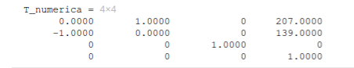
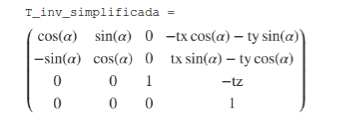
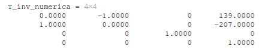

# PRACTICA 4

## 1. Video de resolución
<!--  -->

## 2. Explicación de la solución

### 2.1. Transformación de coordenadas

Para comenzar la práctica necesitaba representar correctamente la posición del robot sobre el mapa proporcionado.

El mapa tiene unas dimensiones de 415x279 píxeles, mientras que las coordenadas obtenidas mediante `HAL.getPose3d()` están expresadas en metros respecto al sistema de referencia de Gazebo.

Por ello, implementé una transformación homogénea que combina rotación y traslación para pasar de las coordenadas de Gazebo a las coordenadas de la imagen. Esto lo realizo utilizando la matriz dada en el enunciado:

Revisando orientaciones del robot llegué a la conclusión de que los valores correctos que añadir a esta transformación para realizar las rotaciones y traslaciones correctas sobre la posicion y orientación iniciales del robot son:

&#x20;   \- alpha = -π/2

&#x20;   \- tx = 207

&#x20;   \- ty = 139

&#x20;   \- tz = 0

&#x20;   \- scale = 20

La rotación de -90° respecto al eje Z permite adaptar la orientación de los ejes de Gazebo a los del mapa, siguiendo la regla de la mano derecha.

Para calcular los valores de traslación utilicé las dimensiones de la imagen, situando el origen de Gazebo aproximadamente en su centro.

&#x20;   tx = 415 / 2 ≈ 207

&#x20;   ty = 279 / 2 ≈ 139

De esta forma, el origen de coordenadas (0, 0) de Gazebo se corresponde con el píxel (207, 139) del mapa.

La transformación utiliza una matriz homogénea de 4x4, que contiene la rotación respecto al eje Z y las componentes de traslación.

Teniendo en cuenta el factor de escala de 20 píxeles por metro, las coordenadas finales se calculan mediante:

&#x20;   x_mapa = 207 + 20 * y_gazebo

&#x20;   y_mapa = 139 - 20 * x_gazebo

Una vez obtenidas las coordenadas en píxeles, utilizo `cv2.circle()` para representar la posición del robot sobre la imagen.

Es importante notar que primero debo aplicar la escala a cada componente x, y, z, en lugar de a la transformada final.

### 2.2. Transformada inversa

Para la planificación de rutas también necesito realizar la operación contraria: obtener las coordenadas de Gazebo a partir de un punto seleccionado sobre el mapa.

Esto es necesario porque el planificador trabajará sobre una imagen expresada en píxeles, mientras que el movimiento del robot debe realizarse utilizando coordenadas métricas.

Para calcular la transformación inversa he utilizado MATLAB, realizando la inversión de la matriz homogénea y simplificando el resultado.

Adjunto la captura del cálculo realizado en el archivo `.mlx`:

Teniendo en cuenta los valores de rotación, traslación y escala utilizados, las expresiones resultantes son:

&#x20;   x_gazebo = (139 - y_mapa) / 20

&#x20;   y_gazebo = (x_mapa - 207) / 20

De esta manera puedo realizar las transformaciones en ambos sentidos, lo que me permitirá convertir las posiciones calculadas por el planificador en objetivos de navegación para el robot.

A diferencia de la trasnformación, debo **dividir** por el factor escala a la transformada final.

**#### Cálculos realizados en MATLAB**

A continuación, adjunto el documento completo con los cálculos de las matrices de transformación y transformación inversa realizados en MATLAB.

<iframe
  src="{{ '/assets/pdf/amazon-warehouse/transformaciones.pdf' | relative_url }}"
  width="100%"
  height="600px"
  style="border: 1px solid #ccc; border-radius: 8px;">
</iframe>

  <a href="{{ '/assets/pdf/amazon-warehouse/transformaciones.pdf' | relative_url }}" download>
    📄 Descargar cálculos de MATLAB (PDF)
  </a>

### 2.3. Procesamiento del mapa

Una vez conseguí representar la posición del robot, comencé a preparar el mapa para las rutas.

En primer lugar, utilizo la función `reset_map()` para convertir el mapa original a escala de grises, distinguiendo las paredes de las zonas transitables. (Funciónd de JDROBOT)

Sin embargo, el robot no puede considerarse como un punto, ya que tiene unas dimensiones físicas que deben tenerse en cuenta al calcular las rutas.

Por ello, he implementado un engrosamiento de los obstáculos utilizando operaciones morfológicas de OpenCV.

### 2.3.1. Engrosamiento de obstáculos

Para ampliar las paredes he utilizado `cv2.erode()` junto con un elemento estructurante elíptico generado mediante `cv2.getStructuringElement()`.

Aunque la operación se denomina erosión, como los obstáculos están representados por píxeles oscuros y las zonas libres por píxeles claros, el resultado es un engrosamiento de las paredes.

El tamaño del elemento estructurante depende de la constante `RADIO_ROBOT`, calculándose de la siguiente manera:

&#x20;   tamaño_kernel = 2 * RADIO_ROBOT + 1

Inicialmente utilicé un radio de 5 píxeles, pero al visualizar el resultado comprobé que las paredes quedaban demasiado engrosadas y reducían considerablemente el espacio disponible para la navegación.

Finalmente, lo reduje a:

&#x20;   RADIO_ROBOT = 4

Esto corresponde a un elemento estructurante de 9x9 píxeles.

Teniendo en cuenta la escala de 20 píxeles por metro, el radio utilizado equivale aproximadamente a:

&#x20;   radio = 4 / 20 = 0.2 m

Este margen permite considerar el tamaño del robot al planificar una ruta, evitando que su centro pase demasiado cerca de los obstáculos.

El mapa engrosado será el que utilice posteriormente para implementar el algoritmo de planificación global.



## 3. Resultado